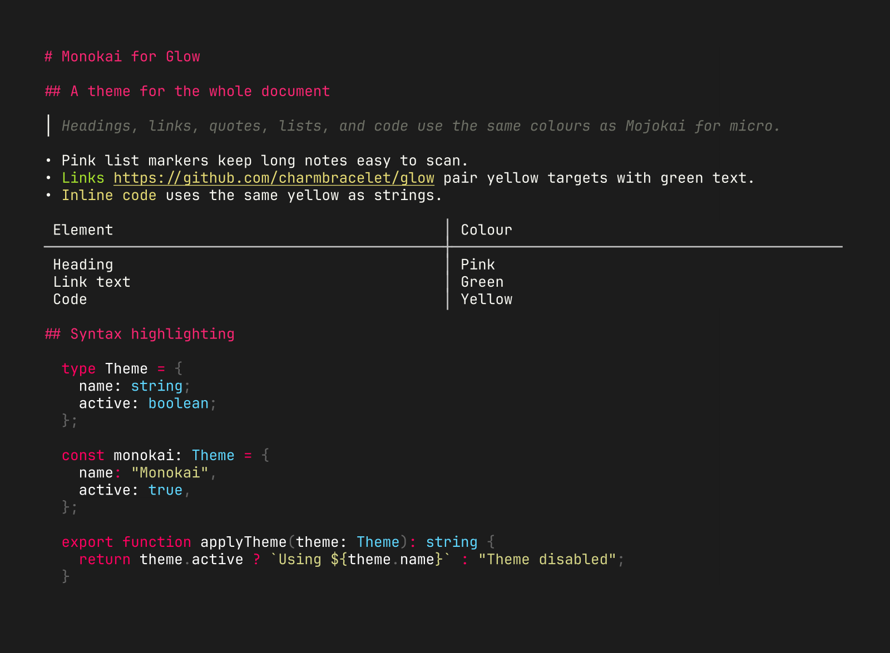

# Monokai for Glow



A Monokai-style theme for [Glow](https://github.com/charmbracelet/glow), matched to [Mojokai for micro](https://github.com/jv-k/micro-mojokai-colorscheme).

## Install

Download the theme to a stable path:

```sh
mkdir -p "$HOME/.config/glow"
curl -fsSL \
  https://raw.githubusercontent.com/jv-k/glow-monokai/main/monokai.json \
  -o "$HOME/.config/glow/monokai.json"
```

Try it without changing your config:

```sh
glow --style "$HOME/.config/glow/monokai.json" README.md
```

To make it the default, run `glow config` and set `style` to the absolute path of the downloaded file:

```yaml
style: "/Users/you/.config/glow/monokai.json"
```

Glamour treats this setting as a file path and does not expand `~`. The setting applies to the CLI renderer and the TUI.

## Demo

The screenshot renders [demo.md](demo.md) with Glow 3.0.0.

## Credits

This theme is maintained by [Jonny](https://github.com/jv-k). [Glow](https://github.com/charmbracelet/glow) and [Glamour](https://github.com/charmbracelet/glamour) are Charm projects. Monokai was created by Wimer Hazenberg.
